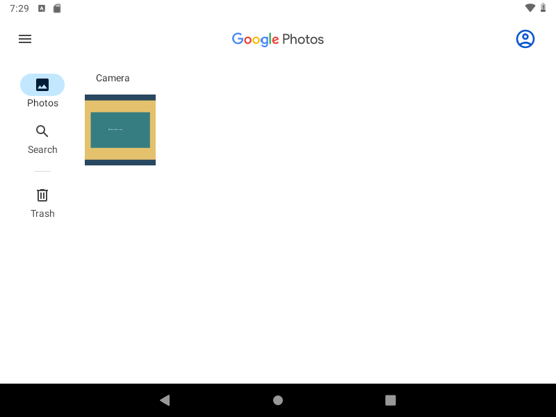

# pixel.iso

### Pixel-inspired Android. A lighter home for Google Photos.

**pixel.iso is a lightweight Android ISO for Intel/AMD virtual machines, with
built-in Magisk root and a custom Pixelify-VM module that mimics the device
identity of the first-generation Google Pixel.**

The **Photos Lite** edition keeps Google Photos, the Google components needed
for account sign-in, a simple home screen and essential Android settings. It
removes bundled extras to reduce background activity on smaller virtual machines.

[Get started](#get-started) · [Choose an edition](#choose-an-edition) ·
[Requirements](#requirements) · [Troubleshooting](#troubleshooting) ·
[Technical documentation](#technical-documentation)



*Actual VirtualBox screenshot. The sample photo belongs to the test VM and is
not bundled in the ISO.*

> **Compatibility:** These downloads are **x86-64 VM images**. They do not boot
> natively on Raspberry Pi. A Raspberry Pi release would need a separate ARM
> image and device-specific drivers; no such build is included here.

## What you get

- **Magisk root, ready to use** — Magisk 26.4 and automatic manager installation.
- **First-generation Pixel identity** — Pixelify-VM 1.0 reports `Google`, `Pixel`
  and `sailfish`, while retaining the VM's real processor architecture.
- **Google Photos included in Lite** — version 7.98.0.1001971222, with Google's
  original APK signature and native x86-64 libraries.
- **Internet through VirtWifi** — fresh VM data connects automatically through
  the virtual machine's NAT adapter.
- **A smaller Android workload** — Lite uses low-RAM mode, a simple launcher,
  disabled animations and fewer cached app processes.
- **A fuller module environment when needed** — the Full edition includes
  LSPosed 1.9.2 with Zygisk enabled.

pixel.iso uses **Android-x86 9.0-r2 / Android 9**. The bundled Photos app is newer
than the OS; this remaster does not upgrade Android or its security patch level.

## Choose an edition

| | Photos Lite — recommended for Photos | Full — for LSPosed and more apps |
|---|---|---|
| ISO file | `androidiso-lite.iso` | `androidiso.iso` |
| Approximate download size | 1.12 GiB | 938 MiB |
| Google Photos | Preinstalled | Install separately |
| Magisk + Pixelify-VM | Included | Included |
| LSPosed | Omitted | Included |
| Zygisk | Disabled | Enabled on first boot |
| Play Store and original bundled apps | Removed | Retained |
| Guest RAM to start with | 1.5–2 GB | 2 GB |
| Detailed guide | [Lite guide](LITE-README.md) | [Full guide](FULL-README.md) |

**Why is Lite's ISO larger?** Lite adds Google Photos and stores app packages
uncompressed inside the system filesystem to reduce decompression stalls. It
targets lower runtime overhead, rather than the smallest download.

Lite keeps Play services, Google Services Framework, account sign-in, WebView,
the keyboard, file/media providers and Android's essential services. Chrome,
Google Search, Gmail, Calendar, the separate gallery, camera, music player,
Taskbar and other bundled extras are removed.

## Requirements

You need a computer that can run a 64-bit Intel/AMD virtual machine. In this
guide, **host** means your real computer and **guest** means Android inside it.

| Setting | Recommended starting point |
|---|---|
| VM application | VirtualBox; verified with version 7.2.22 |
| Guest type | Other Linux (64-bit) |
| Processor | 2 virtual CPUs; hardware virtualization and long mode enabled |
| Guest RAM | 1536–2048 MB for Lite; 2048 MB for Full |
| Virtual disk | A fresh disk of 16 GB or more for persistent use |
| Firmware | Legacy BIOS; Secure Boot off |
| Display | VBoxVGA, 3D acceleration off |
| Video memory | 32 MB tested for Lite; 128 MB for Full |
| Network | Adapter 1 enabled, NAT, Cable connected |

Leave enough memory for your host operating system. Assigning almost all host
RAM to the VM can make both systems slow. VMware and EFI boot are not verified
for this release; VirtualBox with BIOS is the documented starting point.

## Get started

### 1. Choose your ISO

Start with `androidiso-lite.iso` for the Photos-focused
experience. An **ISO** is a virtual installation disc: attach it to the VM's
virtual CD/DVD drive rather than opening it as an Android app.

ISO files are build outputs and are not committed to this source repository.
Use an ISO supplied separately, or follow the build instructions in the technical
guides to create one from the required upstream assets.

### 2. Create a virtual machine

1. Open VirtualBox and select **New**. Name the VM `pixel.iso`.
2. Choose **Linux → Other Linux (64-bit)**. If offered, select **Skip Unattended
   Installation** so you can use the Android boot menu yourself.
3. Set **2 CPUs** and **1536–2048 MB RAM** for Lite.
4. Create a **new virtual hard disk**, at least **16 GB**, if you want to save
   your account, settings and photos between boots.
5. In **Settings → Display**, select **VBoxVGA**, disable **3D Acceleration**,
   and set video memory to **32 MB** for Lite.
6. In **Settings → System**, keep **EFI disabled**. Enable **PAE/NX** if available.
7. In **Settings → Network**, enable Adapter 1, select **NAT**, and check
   **Cable connected**. The tested adapter type is **PCnet-FAST III**.
8. In **Settings → Storage**, select the virtual optical drive, choose the ISO,
   then start the VM. An IDE optical drive was tested.

### 3. Try Android without installing

Choose **Pixel Photos Lite – Live (software graphics)**, the default Lite boot
entry. In the Full edition, the corresponding entry says **Pixel Android VM**.
Allow a few minutes for the first boot and automatic Magisk manager installation.

Open **Google Photos** from the home screen or app drawer. Lite already includes
the app, so you do not need Play Store to install it. Open the profile button in
Photos and choose **Sign in** to begin Google account setup.

> **Live mode is temporary.** It stores guest data in RAM. Accounts, settings,
> added apps and copied photos disappear when you shut down or reboot. A virtual
> disk only provides persistence after Android has been installed onto it.

### 4. Install to keep your data

1. Restart the VM and choose **Install Pixel Photos Lite to virtual hard disk**
   or the matching **Install Pixel Android VM** entry for Full.
2. Choose the **new virtual disk created for this VM**. If it has no partition,
   use **Create/Modify partitions** to create a bootable partition, write the
   partition table, then return to the installer.
3. Select that partition, format it as **ext4**, and install **GRUB** when asked.
   A read-only `/system` is sufficient for the included root integration.
4. Shut down, remove the ISO from the virtual optical drive, and boot from the
   virtual disk.

Formatting erases the selected disk or partition. Use a dedicated virtual disk;
do not attach your host's physical disk to this procedure. Use fresh guest data
for Lite so older apps and modules are not carried over from another edition.
The installer is included, but disk installation and persistence have not yet
been verified in the recorded tests.

## Wi-Fi and internet

Inside Android, connect to **VirtWifi**. This virtual network shares your host's
internet connection through NAT. Your host can use Wi-Fi or Ethernet; Android
does not need to display the same physical Wi-Fi name.

On fresh guest data, connection is automatic. If it is disconnected, check the
VM's **NAT** and **Cable connected** settings, then turn Wi-Fi on in Android and
select **VirtWifi**. Older saved data may need this manual selection once.

## Pixel identity and modules

**Pixelify-VM is this project's custom Magisk module.** It changes product
identity to resemble the original 2016 Pixel (`sailfish`). It is distinct from
Kingsman44's ARM64 Pixelify project.

The module preserves the real x86 CPU architecture, Android version, kernel,
fingerprint, security patch level and signing keys. Pixel-specific hardware,
Pixel Launcher, Call Screen, Google certification and service entitlements are
not supplied by changing a device name. Unlimited Google Photos storage is not
guaranteed.

To inspect or disable the identity module, open **Magisk → Modules**. Disable
**Pixelify-VM** and reboot to restore the original Android-x86 product identity.
The Full edition also includes LSPosed Manager; add any further Xposed modules
yourself. Lite omits that framework to reduce background work.

## Tested performance

| Check | Recorded result |
|---|---|
| Lite with 1 GB guest RAM | Local gallery and image viewing worked |
| Photos memory in the small gallery test | About 72 MiB PSS for the app |
| Lite with 1.5 GB guest RAM | Google's email/phone sign-in form opened without Play Store |
| Networking | Automatic VirtWifi, DHCP, DNS and internet pings passed |
| Magisk and Pixel identity | Verified in the guest |

The app's memory measurement excludes the rest of Android. Account setup was
unreliable at 1 GB, so use **1.5–2 GB** as your starting point. Large libraries,
editing features and optional downloads can need more resources. Completed
Google authentication and cloud backup have not been tested. Performance varies
with the host, and lag-free operation is not guaranteed.

See [Lite test results](LITE-TEST-RESULTS.md) and [Full test results](TEST-RESULTS.md)
for the evidence and remaining limits.

## Troubleshooting

| Problem | What to check |
|---|---|
| “Requires an x86-64 CPU, but only detected an i686 CPU” | Power off the VM. Choose **Other Linux (64-bit)**, enable long mode, and check that hardware virtualization is available on the host. |
| Black screen or graphics trouble | Use **Live (software graphics)**, BIOS, VBoxVGA and 3D acceleration off. Keep the supplied 32-bit framebuffer preset. |
| No internet or no familiar Wi-Fi name | Use **NAT**, check **Cable connected**, then connect Android to **VirtWifi**. |
| Photos stays on “Checking info” | Allow first-boot initialization to finish and check internet access. At 1 GB, shut down and increase guest RAM to **1536–2048 MB**. |
| The VM is slow | Check host memory availability, enable hardware virtualization and close unused host apps. Larger libraries need more resources. |
| Account or photos disappear after reboot | You are probably using Live mode. Install Android to the virtual disk for persistence. |
| LSPosed or Play Store is missing in Lite | Both are intentionally omitted. Choose Full if you need the bundled LSPosed framework and original app set. |
| Raspberry Pi cannot boot the ISO | This release is x86-64. Raspberry Pi needs a separate native ARM build. |

For the CPU error, an optional host-terminal command for a **powered-off** VM
named `pixel.iso` is:

```sh
VBoxManage modifyvm "pixel.iso" --ostype Linux_64 --longmode on --pae on
```

## Verify your download

Keep the ISO and its matching `.sha256` file in the same folder. On Linux, run:

```sh
sha256sum -c androidiso-lite.iso.sha256
```

The expected result is `androidiso-lite.iso: OK`. For Full, use
`sha256sum -c androidiso.iso.sha256` instead.

On Windows PowerShell, calculate the hash with:

```powershell
Get-FileHash .\androidiso-lite.iso -Algorithm SHA256
```

Compare it with the value in `androidiso-lite.iso.sha256`; letter case does not
matter. Component versions and hashes are in the build manifests below.

## Technical documentation

- [Photos Lite guide and Docker rebuild steps](LITE-README.md)
- [Full edition setup, integration and rebuild steps](FULL-README.md)
- [Lite test results](LITE-TEST-RESULTS.md) · [Full test results](TEST-RESULTS.md)
- Generated component records: `BUILD-MANIFEST-lite.json` and `BUILD-MANIFEST.json`
  (created locally during a build)
- [Pixelify-VM module notes](modules/pixelify_vm/README.md)
- Build sources: [ISO builder](build_iso.py), [Lite system builder](build_lite_system.py),
  [filesystem packer](pack_lite_system.sh), [Dockerfile](Dockerfile.lite-build)

## Credits and licensing

pixel.iso combines [Android-x86](https://www.android-x86.org/source.html),
[Magisk](https://github.com/topjohnwu/Magisk/tree/v26.4) and, in Full,
[LSPosed](https://github.com/LSPosed/LSPosed/tree/v1.9.2). Root integration draws
on [initrd-magisk](https://github.com/KhanhNguyen9872/initrd-magisk).
[Kingsman44's Pixelify](https://github.com/Kingsman44/Pixelify) is a separate
project and is not the module bundled here.

Local integration scripts and the custom Pixelify-VM module are provided under
[GPL-3.0-or-later](LICENSE). Bundled components retain their own licenses; Google
applications are proprietary. Google, Android, Pixel and Google Photos are
trademarks of their respective owners. pixel.iso is an independent community
remaster, not an official Google product.
